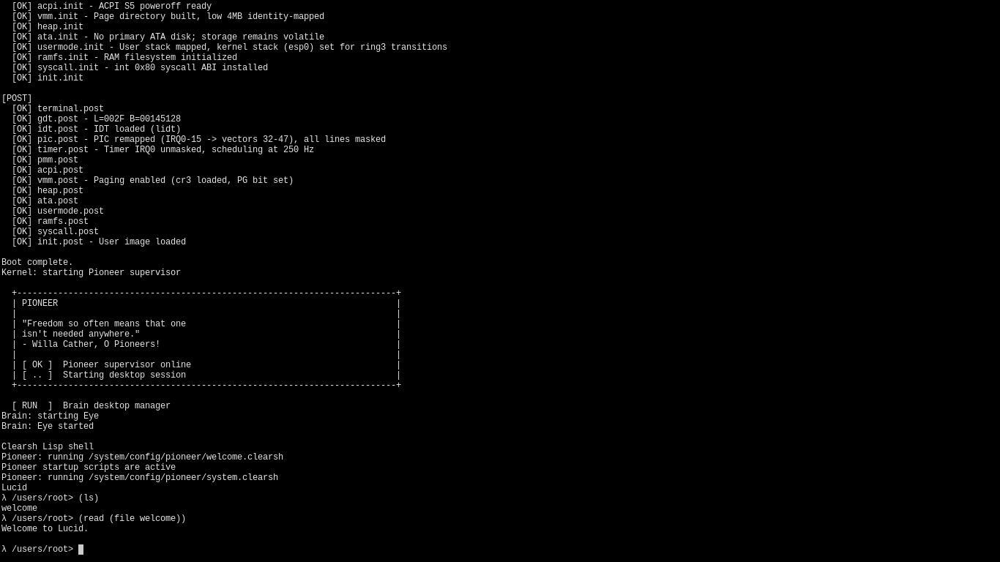

# Lucid Kernel

Lucid is a tiny, non-POSIX x86 hobby OS built on KISS principles and a file-based design. Its user ABI has just two syscalls: path-based read and write. All other kernel services are exposed as virtual files. Featuring a preemptive kernel, Brain WM, Eye terminal, and Clearsh Lisp shell, it targets a 1 MiB kernel and 10 MiB bootable ISO, and already runs on real ThinkPad X201 hardware.


## Philosophy

- **KISS** — keep the user-mode ABI small: two numbered, path-based read/write
  syscalls.
- **File-oriented interface** — higher-level kernel services are accessed
  through virtual paths, alongside regular RAMFS files.
- **Modular architecture** — kernel components use selectable implementations
  configured in `config.mk`.
- **Non-POSIX by design** — Lucid is not bound to POSIX semantics, though it
  includes a small POSIX-style file-I/O compatibility layer.



## Hardware Requirements (minimum)

- CPU: 2+ cores, 32-bit or above
- RAM: 8 MB

Lucid is confirmed working on the Lenovo ThinkPad X201.

## Size Budget

- Kernel image: **max 1 MB**
- ISO image: **target 10 MB**

These are hard constraints, not aspirations. If a feature doesn't fit the budget, it doesn't
ship until something else is cut or the design is simplified.

## Build Toolchain

Toolchain components can be built locally without sudo. Run
`./build.sh install-all` to bootstrap them; this requires Git, GCC, GNU Make,
tar, curl or wget, Bison, and Flex on the host. Building the ISO also requires
NASM, GNU ld, and Python 3.

- **tcc** — C99 compiler
- **python3** — build-time BDF font conversion
- **mtools** — FAT image manipulation
- **xorriso** — ISO 9660 image creation
- **grub** — bootloader (temporary; to be replaced by something simpler later)

These are host-side build tools, not programs in the booted kernel image.
Clearsh cannot run TCC yet: Lucid does not have a general executable loader or
an ISO filesystem interface. `exec` currently supports only the embedded
Brain, Eye, Pioneer, and Clearsh images. Brain starts first and launches an
Eye terminal running Clearsh.

## Usage

```
./build.sh                  build only
./build.sh run              build + boot in QEMU (serial output in terminal)
./build.sh test             host wrapper tests + headless ring-3 smoke test
./build.sh disk             create a bootable 128 MiB BIOS disk image
./build.sh disk-run         create and boot that image in QEMU
./build.sh clean            remove build artifacts
./build.sh install-tcc      build TCC locally
./build.sh install-xorriso  build xorriso locally
./build.sh install-mtools   build mtools locally
./build.sh install-grub     build GRUB locally
./build.sh install-all      build all of the above, in dependency order
make get-font               download the Curie bitmap font
```

`tools/lucidc.py` is a small host-side cross-compiler for a C-like subset that
emits 32-bit Lucid user images. See [LUCIDC.md](LUCIDC.md) for the language,
compiler command, and current image-loader limitations.

### Compile and run

From the repository root, fetch the font once and build the bootable ISO:

```sh
make get-font
./build.sh
```

`./build.sh run` boots into the terminal-only serial console by default, using
text-mode dimensions instead of assuming a graphical framebuffer. Use
`QEMU_DISPLAY=gtk ./build.sh run` for the graphical framebuffer VM, or
`./build.sh test` for the host POSIX-wrapper tests and a bounded, headless
ring-3 integration test. The integration test exercises the read/write syscall
ABI, virtual filesystem operations, process control, timing, file watches, and
POSIX descriptor wrappers. The default timeout is 30 seconds; set
`QEMU_TEST_TIMEOUT=60s` to extend it.
If the bundled compiler and image tools are missing, `./build.sh install-all`
builds local copies under `.thirdparty/local`.

### Build configuration

`build.sh` reads its build settings from [`config.mk`](config.mk). The main
settings are:

| Setting | Meaning |
|---|---|
| `INIT_BOOT` | Comma-separated list of boot recipes. Order matters: the build checks that each recipe's dependencies appear earlier in the list. |
| `SYSCALLS` | Comma-separated list of numbered syscall modules. Lucid currently enables only `fs_read` and `fs_write`; kernel operations are exposed through virtual files. |
| `SYSCALL_IMPL` | Selects the transport/dispatcher for the filesystem calls, currently `int80`. |
| `<RECIPE>_IMPL` | Selects the implementation directory for a recipe; for example, `TIMER_IMPL=pit250hz` selects `impl/timer/pit250hz`. The selected directory must exist. |
| `MEMORY_MB` | RAM assigned to QEMU and the physical-memory range managed by the kernel's frame allocator. The allocator assumes this range is contiguous and does not yet read the firmware memory map. |
| `LOW_RESERVED_MB` | Physical memory below this many MiB is reserved and never allocated; the default is 4 MiB. Use `1 <= LOW_RESERVED_MB < MEMORY_MB`. |
| `*_TEST_IMPL` | Test implementation selectors currently present in `config.mk`; `build.sh` does not use them in the normal build. |

For example, set `MEMORY_MB=512` to give QEMU 512 MiB and configure the
allocator for the same range. After changing `config.mk`, run `./build.sh` to
rebuild the kernel and ISO. The size-budget checks still apply.

### Add a boot service

Boot services are called recipes. The build generates the init table from
`INIT_BOOT` and compiles the selected implementation automatically; do not edit
`.build/init_table.c`.

For example, to add a `logger` service:

1. Declare its boot phases and public API in `recipes/logger.h`:

   ```c
   #ifndef LUCID_RECIPE_LOGGER_H
   #define LUCID_RECIPE_LOGGER_H

   #include "status.h"

   /* REQUIRES: terminal */

   lucid_status logger_pre(void);
   lucid_status logger_init(void);
   lucid_status logger_post(void);

   void logger_write(const char *message);

   #endif
   ```

   List every boot recipe it depends on in `REQUIRES`; dependencies must also
   be in `INIT_BOOT` and appear before `logger`.
2. Implement those three phase functions in a selected implementation
   directory, such as `impl/logger/basic/logger.c`. Each returns a
   `lucid_status` (`LUCID_OK` on success); a nonzero `ok` reports failure and
   stops boot. Put the service functions, such as `logger_write`, in the same
   implementation.
3. In `config.mk`, set `LOGGER_IMPL=basic` and add `logger` to `INIT_BOOT`
   after its dependencies. The selector must match the implementation
   directory name.
4. Build and smoke-test with `./build.sh` and `./build.sh test`. The build
   checks dependency order, generates the table, and compiles source files
   under the selected implementation directory.

### Use syscalls

The easiest way to try a syscall in Clearsh is through its virtual syscall
files:

```lisp
(write (file /system/terminals/current) (text "Hello from Lucid!\n"))
(print (read (file /system/syscalls/get_ticks)))
```

Clearsh also provides a checked `(syscall number ...)` form, limited to
filesystem read (3) and write (4). Arguments are typed shell values; Clearsh
does not expose raw kernel pointers. Other operations use virtual file
endpoints such as `/system/syscalls/get_ticks` and
`/system/processes/current/fork`.

A ring-3 C program uses Lucid's small libc for file I/O and
`recipes/syscall.h` for helpers such as process control. The raw `int 0x80`
transport is internal to the libc:

```c
#define LUCID_USER
#include <lucid.h>
#include "recipes/syscall.h"

__attribute__((section(".entry")))
void example_user_entry(void)
{
    static const char message[] = "Hello from ring 3!\n";
    (void)lucid_fs_write("/tmp/hello", message, sizeof(message) - 1);
    lucid_process_exit(0);
}
```

On success, filesystem writes return the number of bytes written; ordinary I/O
failures return `SYS_UNKNOWN_TEST`, while POSIX descriptor endpoints return
negative errno values. The kernel validates user pointers before accessing
them. See [SYSCALLS.md](SYSCALLS.md) for the two syscall numbers and virtual
file endpoints. User images must currently be embedded and registered in the
kernel before `exec` can run them.

### Make a bootable USB

Build `lucid.iso` as above, then identify the USB device and unmount any of its
mounted partitions:

```sh
lsblk -o NAME,SIZE,MODEL,TRAN,MOUNTPOINTS
```

Unmount every mounted partition on the USB (repeat for each listed partition,
replacing the example device name as needed):

```sh
sudo umount /dev/sdX1
```

Write the ISO to the whole device (replace `/dev/sdX` with the USB device,
not a partition such as `/dev/sdX1`):

```sh
sudo dd if=lucid.iso of=/dev/sdX bs=4M status=progress conv=fsync
sync
```

> **Warning:** This erases the selected device. Verify its name and size with
> `lsblk` before running `dd`; choosing the wrong device can destroy your
> computer's data.

Safely eject the USB, connect it to the target computer, and select it from
the boot menu (F12 on the ThinkPad X201). The ISO boots in legacy BIOS mode.
It is a live image: files kept only in RAMFS are lost when the machine powers
off.

Lucid requests a 1024x768x32 GRUB framebuffer and renders console text with
Curie's 6x12 regular BDF glyphs.
If the bootloader cannot provide a compatible RGB framebuffer, output falls
back to VGA text mode. The font's SIL Open Font License is included in the
boot image. On the framebuffer console, Clearsh zoom is set by writing `1`
through `4` to `/system/config/clearsh/zoom` (default `1`); the display and
terminal dimensions update immediately. `/system/config/clearsh/prompt`
controls the shell prompt; `%p` expands to the current directory and `%%`
prints a literal percent sign. The default is `λ %p> `. Clearsh rereads the
prompt file for each command. VGA text mode keeps its native size.

To compare against the standard VGA text font, build and boot with
`LUCID_TEXT_MODE=1 QEMU_DISPLAY=gtk ./build.sh run`. This skips GRUB's graphics
mode and exercises the kernel's VGA text fallback; the default framebuffer
mode is unchanged.

Clearsh supports Ctrl+Left/Right word movement, Ctrl+A/E line boundaries,
Ctrl+U/K deletion to the beginning/end of the line, Ctrl+W deletion of the
previous word, and Ctrl+L to clear the display. Tab completes Clearsh function
names and filesystem paths. Common syscalls are exposed as virtual files under
`/system/syscalls`; see [Use syscalls](#use-syscalls) for examples. Set
framebuffer zoom with
`(write (file /system/config/clearsh/zoom) (text "2"))`. The current edit
position is highlighted, and `vi` redraws only changed screen spans, avoiding
full-screen redraws on keystrokes. Boot output is preserved after the initial
banner, and the terminal halts while waiting for input instead of
busy-spinning. Built-in runtime guides are available in the RAMFS root:
`/README.TXT`, `/CLEARSH.TXT`, `/BRAIN.TXT`, and `/SYSTEM.TXT`.
Poweroff uses ACPI S5 when firmware provides it, with QEMU/Bochs legacy-port
fallback; shutting down a QEMU guest exits QEMU but leaves the host running.

Brain uses a dwm-inspired master/stack layout. Mod is either Alt key:
Mod+Enter starts a terminal, Mod+Q closes the focused terminal, and
Mod+Shift+Q exits Brain. Mod+J/K changes focus, Mod+Shift+H/L adjusts the
master pane, Mod+0..9 switches desktops, and Mod+Shift+0..9 moves the focused
terminal. Bindings are read from `/system/config/brain/keys`; values use
`alt+<key>`, `alt+shift+<key>`, `alt+digit`, or `alt+shift+digit`.
`/system/config/brain/layout` controls the desktop count, startup/log desktops,
initial master ratio, resize limits, and resize step.
`/system/config/brain/theme` controls the status-bar
position (`top`, `bottom`, `left`, `right`) and `background`, `foreground`, and
`accent` colors as six-digit RGB values without `#`. The layout keys are
`desktops` (1-10), zero-based `startup_desktop` and `log_desktop` (each below
the desktop count), `master_ratio`, `master_min_ratio`, `master_max_ratio`,
and `master_step`. Ratios and resize steps are 1-99; the minimum must be below
the maximum. Key names in `brain/keys` are `key_open`, `key_close`,
`key_focus_next`,
`key_focus_previous`, `key_exit`, `key_master_shrink`, `key_master_grow`,
`key_switch_desktop`, and `key_move_desktop`. These files are reloaded when
written. The compatibility file `/system/config/brain.conf` still supplies
`bar=` if the theme file omits it.

The default layout has ten desktops, shows logs in window 1 on desktop 1, and
starts a terminal on desktop 2. Empty desktops default to black; the theme file
can change that. For example, from Clearsh run
`(write (file /system/config/brain/layout) (text "desktops=5\nstartup_desktop=2\nlog_desktop=1\nmaster_ratio=60\n"))`.

The status-bar worker runs the Clearsh script named by
`/system/config/brain/statusbar` every `interval_ms` (default: 5000). A script
writes its text to the configured `output` path; if you change that path, update
the script's output target as well. The sample
`/users/root/example-scripts/statusbar.csh` shows the format. Changes to the
script and interval take effect while Brain is running.

`disk` produces `lucid-disk.img`: a GRUB/MBR boot disk with a FAT32 boot
partition and a Lucid data partition for persistent shell files. It is safe to
test with QEMU. Writing the image to a physical disk overwrites that disk;
Clearsh's `(install)` does not perform physical-disk partitioning. Disk-image
creation additionally requires host `sfdisk` and `mkfs.fat`. The current ATA
driver does not issue cache-flush commands, so persistence is verified across
guest restarts, not sudden power loss.
